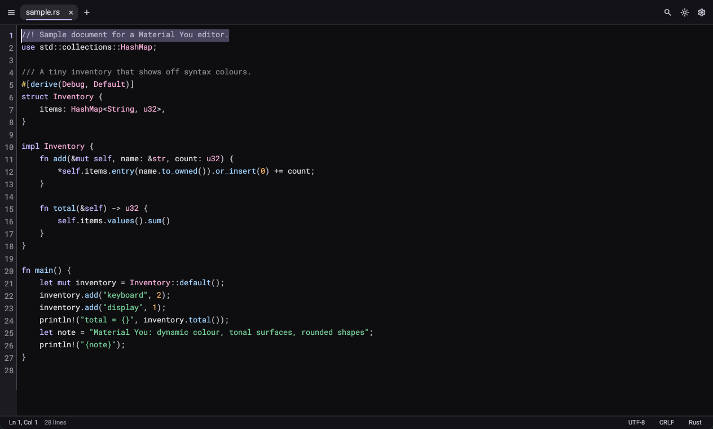
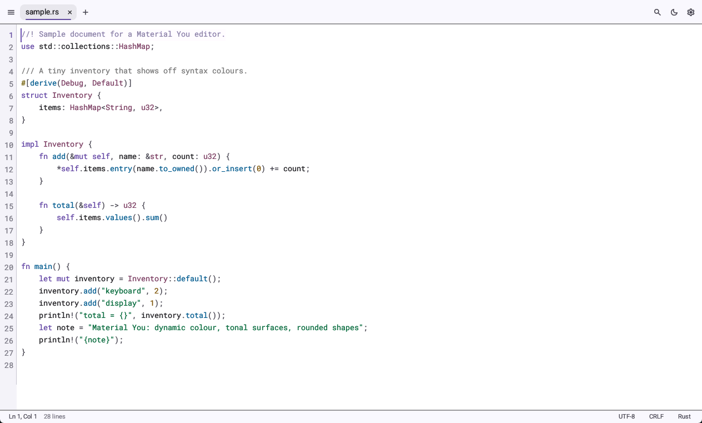
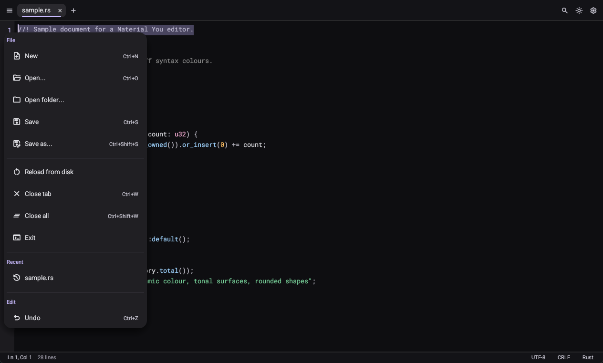
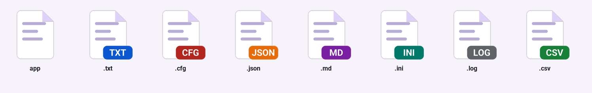

# Material Notepad

**Notepad Next, rewritten in Rust with a Material You interface.**

A fast, quiet text editor for Windows: one native executable, no Electron, no Qt runtime,
no accounts, no telemetry. The chrome is deliberately thin - a 40 px top bar and a 24 px
status strip - so the document gets the window.

[](https://github.com/romareyme/material-notepad/releases/latest)
[](LICENSE)
[](#install)
[](https://www.rust-lang.org)
[](#build-from-source)



## Why this editor

| | Material Notepad | Notepad Next | Notepad++ |
| --- | --- | --- | --- |
| Runtime | one 7 MB `.exe`, no dependencies | Qt DLLs | Win32 + plugins |
| Interface | Material You (Material 3) | classic Qt | classic Win32 |
| Chrome | 40 px bar, no side rail by default | toolbars, docked panels | menu + toolbars |
| Install rights | per user, no administrator prompt | installer | installer |
| File-type icons | per-extension badges | generic | configurable |
| Codebase | Rust, safe by default | C++ / Qt | C++ |

What that buys you in practice:

- **Starts instantly.** A single statically linked binary; no framework to boot.
- **Nothing between you and the text.** No ribbon, no side rail on startup, no panels
  fighting for space: line numbers, the document, and a status line.
- **One colour model everywhere.** Every surface, label and syntax token comes from an
  OKLCH tonal palette, so light and dark themes stay consistent instead of being patched
  separately.
- **No administrator rights, ever.** The installer is per user; the portable build needs
  nothing at all.
- **Text handling that respects the file.** UTF-8, UTF-8 with BOM, UTF-16 LE/BE and
  Latin-1, with LF / CRLF / CR line endings detected per document and switchable.

## Features

### Editing

- Tabs with an inline close button; long names elide inside the tab instead of spilling over.
- **Syntax highlighting for 52 languages**, driven by a hand-written lexer: Rust, C, C++,
  C#, Java, Python, JavaScript, TypeScript, Go, Ruby, PHP, SQL, JSON, YAML, TOML, shell,
  HTML, CSS, Markdown and more.
- Line numbers with the current line highlighted; optional word wrap.
- Find and replace with regular expressions, whole-word and case modes, and match count.
- **Find in files** across a folder, with a results list that jumps straight to the hit.
- Go to line, duplicate/delete/move lines, toggle comment, indent and outdent selection.
- Undo/redo, multi-cursor-free simplicity, selection-aware Tab and Enter (Enter keeps the
  indentation of the current line).
- `Ctrl` + mouse wheel zooms the editor font; the status bar reports size, encoding and EOL.

### Interface

- Material You design: tonal surfaces, state layers, pill buttons, rounded menus, Material
  Symbols icons, Roboto and Roboto Mono embedded in the binary.
- Light and dark themes from one palette, switchable from the settings panel.
- Thin 40 px top bar: menu, tabs, find, theme, settings. Everything else is the document.
- Menus open on a row boundary so a scrolled menu never shows a half row.
- Ephemeral side panel for search results and the file tree, closed by its header button.

### Files and session

- Opens files from the command line, the Start Menu, or Explorer.
- Session restore: documents, cursor positions and unsaved buffers come back after a crash
  or a restart (backups are written next to the configuration).
- Detects external changes to a file and offers to reload.
- Recent files list, remembered last folder.

### Platform integration

- Per-user installer: asks for a directory, offers a Start Menu shortcut, never elevates.
- **Document icons per file type**, each with a coloured badge for the extension
  (`txt`, `cfg`, `json`, `md`, `ini`, `log`, `csv`) - see the [icon set](docs/screenshots/icons-preview.png).
- Registered for "Open with", with a ProgID per type so Explorer can draw the right icon.
- Portable archive: unpack and run, or install per user with one script.

## Screenshots

| Dark theme | Light theme |
| --- | --- |
|  |  |

| File menu with recent files | Document icons per file type |
| --- | --- |
|  |  |

## Install

**1. Installer** - download `MaterialNotepad-1.0.0-setup.exe` from
[Releases](https://github.com/romareyme/material-notepad/releases/latest) and run it. It
installs for the current user into `%LOCALAPPDATA%\Programs\Material Notepad` by default and
never asks for administrator rights.

**2. Portable** - download `material-notepad-portable.zip`, unpack anywhere, run
`material-notepad.exe`. To get the Start Menu entry, the file associations and the
per-type icons:

```powershell
powershell -ExecutionPolicy Bypass -File "Material Notepad\install-per-user.ps1"
```

Remove it again with `-Uninstall`.

**3. From source** - see below.

> If the installer stops with `Ошибка 5: Отказано в доступе` while creating
> `%TEMP%\is-XXXX.tmp`, the temporary directory is not writable for that process. Inno Setup
> unpacks itself before any of this project's code runs, so use the portable archive - it
> never touches `%TEMP%`.

## Keyboard shortcuts

| Action | Shortcut |
| --- | --- |
| New / Open / Save / Save as | `Ctrl+N` / `Ctrl+O` / `Ctrl+S` / `Ctrl+Shift+S` |
| Close tab / Exit | `Ctrl+W` / `Alt+F4` |
| Find / Replace / Find in files | `Ctrl+F` / `Ctrl+H` / `Ctrl+Shift+F` |
| Go to line | `Ctrl+G` |
| Toggle comment | `Ctrl+/` |
| Duplicate line | `Ctrl+D` |
| Delete line | `Ctrl+Shift+K` |
| Move line up / down | `Alt+Up` / `Alt+Down` |
| New tab / Next tab | `Ctrl+T` / `Ctrl+Tab` |
| Select all / undo / redo | `Ctrl+A` / `Ctrl+Z` / `Ctrl+Y` |
| Zoom in / out / reset | `Ctrl++` / `Ctrl+-` / `Ctrl+0` |
| Zoom with the wheel | `Ctrl` + mouse wheel |
| Find next / previous | `F3` / `Shift+F3` |
| Menu bar | `F10` |
| Settings | `Ctrl+,` |
| Shortcut reference | `F1` |

## Build from source

Requirements: Rust (stable), a C toolchain, and - only for the installer - Inno Setup 6.

```powershell
cargo build --release          # target\release\material-notepad.exe
cargo test                     # 38 tests
python tools\make_icons.py     # regenerate the icon set
python tools\gen_installer.py  # regenerate installer\MaterialNotepad.iss
ISCC.exe installer\MaterialNotepad.iss
```

The build embeds `assets/icon.ico` and the version resource through `build.rs`; there is no
runtime asset directory to ship.

### Project layout

```
src/app.rs        shell: top bar, tabs, menus, dialogs, status bar, session
src/editor.rs     the widget: gutter, highlights, selection, key handling
src/document.rs   text buffer, line index, encodings, EOL, cursor
src/highlight.rs  lexer and the 52 language definitions
src/search.rs     find, replace, find in files
src/theme.rs      OKLCH tonal palettes, light and dark schemes, type scale
src/widgets.rs    Material 3 buttons, tabs, switches, text fields, menus
src/icons.rs      Material Symbols subset, generated as glyph codepoints
src/session.rs    settings, session and backups under %APPDATA%\MaterialNotepad
vendor/egui-winit patched so Ctrl+letter works on non-Latin layouts
```

## Configuration

Settings live in `%APPDATA%\MaterialNotepad\settings.json`: theme, palette seed, UI scale,
editor font size, tab width, spaces for tabs, word wrap, line numbers, session restore and
the recent list. The session itself and unsaved-buffer backups sit next to it.

## Notes and limitations

- The shipped binary targets Windows 10/11 x64. The code itself is portable Rust + egui.
- No plugin system and no LSP: this is a text editor, not an IDE.
- The editor keeps its own caret bookkeeping besides egui's, so a few interactions (undo
  granularity after a command, for instance) are coarser than in a plain widget.

## Credits

- [Notepad Next](https://github.com/dail8859/notepad-next) by Justin Dailey - the C++/Qt
  editor this project re-imagines.
- [egui](https://github.com/emilk/egui) and [eframe](https://github.com/emilk/egui) - the
  immediate-mode GUI the interface is built on.
- [Roboto](https://fonts.google.com/specimen/Roboto) and
  [Material Symbols](https://fonts.google.com/icons) - the type and icons.
- [Material 3](https://m3.material.io) - the design system.

## License

GPL-3.0-or-later, the same licence as Notepad Next. See [LICENSE](LICENSE).
